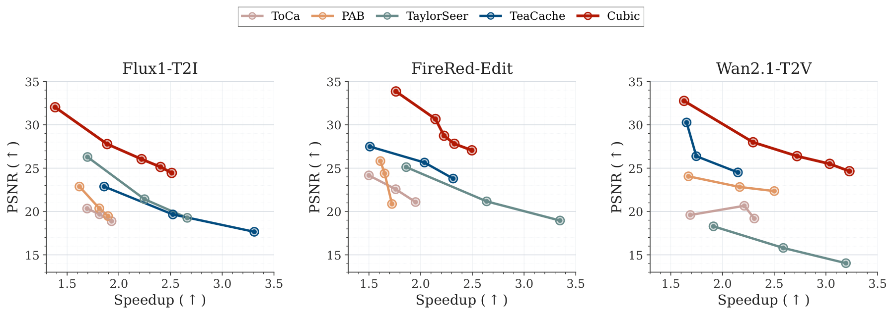
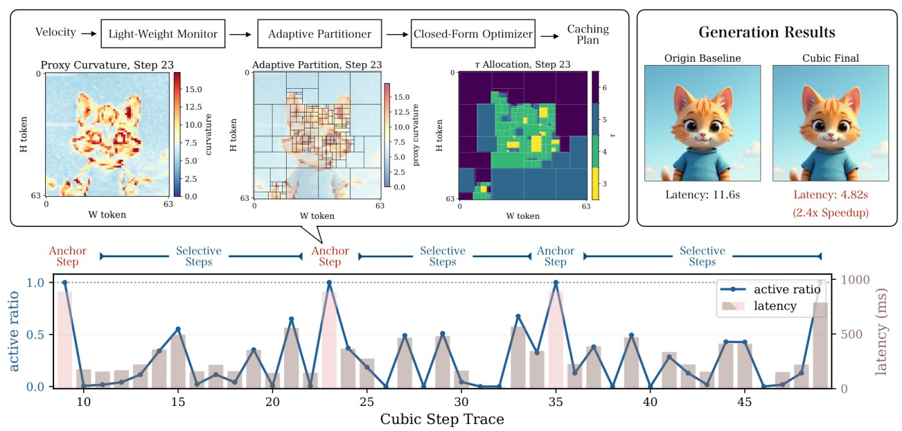

<div align="center">

# CUBIC: Curvature-Driven Dynamic Inference Caching for Fast, High-Fidelity Flow Matching

**NeurIPS 2026**

Yuyang Chen<sup>\*1</sup>, Linqian Zeng<sup>\*1</sup>, Yijin Zhou<sup>1</sup>, Hengjie Li<sup>2</sup>, Jidong Zhai<sup>3</sup>

<sup>1</sup>Shanghai Jiao Tong University &nbsp; <sup>2</sup>Shanghai AI Laboratory &nbsp; <sup>3</sup>Tsinghua University &nbsp; <sup>\*</sup>Equal contribution

[Project Page](https://chen-yy20.github.io/CuBic/) · Paper (coming soon) · [Citation](#citation)

</div>

<p align="center"></p>

CUBIC is a training-free caching framework for Flow Matching models. It measures the local **curvature** of the sampling trajectory, recomputes high-curvature regions often and reuses cached results for flat regions, and executes the resulting sparse schedule with a dedicated forward engine. A single knob, the target speedup, controls the compute budget.

## News

- **2026.11** CUBIC is accepted to NeurIPS 2026. Code and experiment scripts are released.

## Highlights

- **Principled scheduling.** Under a forward-Euler analysis, the error of reusing a velocity grows with local curvature. CUBIC turns this into a closed-form, budget-constrained allocation of per-block update intervals, $\tau_b \propto \kappa_b^{-\gamma}$.
- **Lightweight curvature proxy.** Curvature is estimated from endpoint drift between anchor steps, using only quantities the sampler already computes. No Jacobians and no extra forward passes.
- **Real speedup, not just fewer tokens.** A sparse forward engine recomputes only active blocks and refreshes a layer-wise KV pool in place, so reduced token computation becomes wall-clock speedup.
- **Model-agnostic.** The same framework runs on text-to-image (Flux.1-dev), instruction-guided image editing (FireRed-Image-Edit-1.0), and text-to-video (Wan2.1-T2V-1.3B).

## Method

<p align="center"></p>

CUBIC alternates between **anchor steps** and **selective steps**. At an anchor step, all tokens are computed; the monitor estimates curvature, the partitioner groups tokens into blocks, and the optimizer assigns each block an update interval under the target budget. During the following selective steps, only blocks whose interval has elapsed are recomputed, while the others reuse cached outputs and KV.

## Results

Main results on NVIDIA H100. Fidelity metrics are measured against the uncached model with the same prompt and seed.

| Model | Method | Speedup | PSNR ↑ | SSIM ↑ | LPIPS ↓ |
| --- | --- | :-: | :-: | :-: | :-: |
| Flux.1-dev | TaylorSeer | 1.70× | 26.29 | 0.892 | 0.099 |
| | **CUBIC (std)** | **1.89×** | **27.78** | **0.900** | **0.095** |
| | **CUBIC (fast)** | **2.40×** | 25.14 | 0.846 | 0.173 |
| FireRed-Image-Edit | TeaCache | 2.31× | 23.80 | 0.896 | 0.100 |
| | **CUBIC (std)** | 2.14× | **30.67** | **0.954** | **0.047** |
| | **CUBIC (fast)** | **2.33×** | 27.81 | 0.920 | 0.091 |
| Wan2.1-T2V-1.3B | TaylorSeer | 2.59× | 15.80 | 0.641 | 0.352 |
| | **CUBIC (std)** | 1.63× | **32.76** | **0.948** | **0.032** |
| | **CUBIC (fast)** | **2.72×** | 26.39 | 0.874 | 0.099 |

The full comparison with PAB, ToCa, TeaCache, TaylorSeer and Jano, including FID/FVD, HPSv3 and VBench, is in the paper.

## Installation

Requirements: Linux, an NVIDIA GPU with CUDA 12.8, and Python 3.12. Dependencies are managed with [uv](https://docs.astral.sh/uv/).

```bash
git clone https://github.com/chen-yy20/CuBic.git && cd CuBic
uv sync                      # installs PyTorch 2.8 (cu128), diffusers, flash-attn, ...
source .venv/bin/activate
```

Download the model weights you need:

| Task | Model |
| --- | --- |
| Text-to-image | [FLUX.1-dev](https://huggingface.co/black-forest-labs/FLUX.1-dev) |
| Image editing | FireRed-Image-Edit-1.0 |
| Text-to-video | [Wan2.1-T2V-1.3B](https://huggingface.co/Wan-AI/Wan2.1-T2V-1.3B) |

## Quick Start

All experiments go through `launch.py`, which maps `--model` and `--method` to a script and forwards everything after `--`:

```bash
python launch.py --model <flux|firered|wan|flux2k> --method <ori|cubic|...> \
    --launcher python --model-path /path/to/weights -- [script args]
```

```bash
# Uncached reference
python launch.py --model flux --method ori --launcher python --model-path /path/to/FLUX.1-dev

# Flux.1-dev text-to-image; lower tolerance = higher fidelity, higher = faster
python launch.py --model flux --method cubic --launcher python --model-path /path/to/FLUX.1-dev \
    -- --prompt "A photorealistic cute cat wearing a blue shirt" --cubic_curvature_error_tolerance 2e-4

# Wan2.1 text-to-video with a target selective-phase speedup
python launch.py --model wan --method cubic --launcher python --model-path /path/to/Wan2.1-T2V-1.3B \
    -- --target_speedup 6 --warmup_steps 11 --cooldown_steps 1

# FireRed image editing (separate budgets for edited and reference tokens)
python launch.py --model firered --method cubic --launcher python --model-path /path/to/FireRed-Image-Edit-1.0 \
    -- --input_image input.png --prompt "change the cat to a white cat" \
       --cubic_target_speedup 4 --cubic_cond_target_speedup 12
```

Use `--launcher srun` (the default) with `--partition` and `--gpus` on a SLURM cluster; Wan supports 2-GPU CFG parallelism via `--gpus 2`. Outputs, timing statistics and quality metrics are written to `results/<model>/...`, with a `*_params_metrics.json` summary per run.

Baselines are available through the same launcher, for example `--method teacache`, `pab`, `tocache` or `jano` (see `SCRIPT_MAP` in `launch.py` for the full list per model).

## Repository Structure

```text
cubic_core/     Model-agnostic core: curvature monitor, partitioner, interval optimizer, scheduler
flux1_exp/      Flux.1-dev integration and baselines
firered_exp/    FireRed-Image-Edit integration and adapted baselines
wan_exp/        Wan2.1 integration and baselines
flux2k_exp/     Flux.2-klein (4-step distilled) integration
baseline/       Baseline adaptations shared across models
eval/           Quality evaluation (VBench, HPSv3)
autocode/       Ablation and sweep scripts (anchor horizon, block granularity, Jano comparison)
utils/          Timing, metrics (PSNR/SSIM/LPIPS/FID) and result helpers
tests/          Unit tests for the optimizer, partitioner and scheduler
```

Run the unit tests with `python -m pytest tests`.

## Citation

```bibtex
@inproceedings{chen2026cubic,
  title     = {{CUBIC}: Curvature-Driven Dynamic Inference Caching for Fast, High-Fidelity Flow Matching},
  author    = {Chen, Yuyang and Zeng, Linqian and Zhou, Yijin and Li, Hengjie and Zhai, Jidong},
  booktitle = {Advances in Neural Information Processing Systems},
  year      = {2026}
}
```

## Acknowledgements

This codebase builds on [Wan2.1](https://github.com/Wan-Video/Wan2.1), [diffusers](https://github.com/huggingface/diffusers) and [FLUX](https://github.com/black-forest-labs/flux). Baseline implementations are adapted from the official releases of [TeaCache](https://github.com/ali-vilab/TeaCache), [PAB](https://github.com/NUS-HPC-AI-Lab/VideoSys), [ToCa](https://github.com/Shenyi-Z/ToCa), [TaylorSeer](https://github.com/Shenyi-Z/TaylorSeer) and [Jano](https://arxiv.org/abs/2603.00519).
